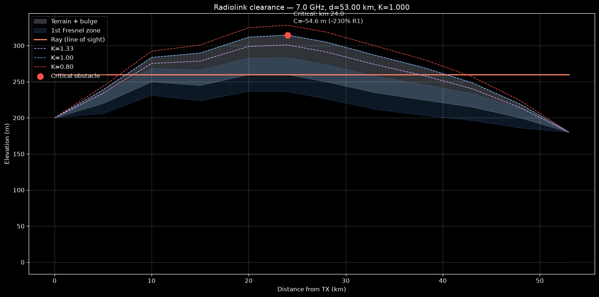

# RadioLink Clearance Suite


## Objective

A dynamic, scalable and automated Python engineering suite for **microwave radiolink clearance analysis** (Fresnel zones and earth curvature under tropospheric refraction), compliant with the **ITU-R P.530-18** clearance criteria. It replaces static spreadsheet calculation templates with a vectorized, tested and production-ready engine — CLI, Python API and interactive dashboard.

## Theory at a glance

A microwave link needs radio line-of-sight, but the first Fresnel volume interacts with the ground. Two corrections dominate the analysis:

- **Tropospheric refraction (ITU-R P.453):** the refractivity gradient bends the ray; the equivalent-earth factor **K** absorbs the curvature into a modified earth radius (bulge: `f(x) = 0.0785 · d1 · d2 / K`).
- **Fresnel zones (Huygens-Fresnel):** the nth ellipsoid radius in the path is `R1 = 17.32 · sqrt(d1 · d2 / (f_ghz · d_km))`; the criterion is a minimum clearance fraction of R1 (typical 60% under K=4/3, stricter under sub-refractive episodes like K=0.8, and 100% above 10 GHz).

## Repository layout

```text
radiolink-clearance/
├── src/radiolink/
│   ├── models.py         # immutable dataclasses (ClearancePoint, ClearanceSummary)
│   ├── core.py           # RadioLinkEngine: terrain, bulge, Fresnel, clearance, summary
│   ├── optimizer.py      # TowerOptimizer: minimum tower heights via bisection
│   ├── plotting.py       # technical profile figure (dark mode, K variations)
│   ├── io.py             # CSV and Excel profile ingestion
│   ├── cli.py            # radiolink-cli
│   └── __init__.py
├── app/
│   └── streamlit_app.py  # interactive dashboard (sliders, optimize, export)
├── data/
│   └── sample_profile.csv
├── tests/
│   └── test_clearance.py # 6 tests (analytic references + optimizer + io)
├── pyproject.toml          # PEP 517/621 packaging + ruff config
├── requirements.txt
└── .github/workflows/ci.yml
```

## Execution

```bash
python -m venv .venv
source .venv/bin/activate      # Windows: .venv\Scripts\activate
pip install -e ".[gui,test]"

# CLI
radiolink-cli --file data/sample_profile.csv --freq 7.0 --h1 60 --h2 80 --k 1.333 --rf 0.6 --optimize --plot vano.png

# Dashboard
streamlit run app/streamlit_app.py

# Tests
pytest tests/ -q
```

## Sample run (terrain profile from `data/sample_profile.csv`)

```text
=================================================================
           RADIOLINK CLEARANCE ANALYSIS REPORT
=================================================================
Path Length        : 53.00 km
Frequency          : 7.00 GHz
Atmospheric Factor : K = 1.000
Antenna Heights    : h1 = 60.0 m | h2 = 80.0 m
Target Clearance   : 60% of 1st Fresnel zone
-----------------------------------------------------------------
Critical Obstacle  : Distance = 24.00 km | Elevation = 314.6 m
Net Clearance (C)  : -54.64 m
Clearance Ratio    : -230.3% R1
Status             : OBSTRUIDO (NO CUMPLE)
=================================================================
Optimization (balanced towers): h1 = 129.3 m, h2 = 149.3 m
```



## Tests

```bash
pytest tests/ -q
# 6 passed — analytic references (Fresnel midpoint, bulge formula),
# compliance/optimizer round-trips, CLI smoke and CSS ingestion.
```

## Engineering notes

- The CLI returns **exit code 1** when the link does not comply — the exit code is the gate for batch CI pipelines
- `TowerOptimizer` solves the minimum balanced tower heights by bisection over the height increment (the critical-point clearance is linear in height) — O(60 iterations) with 0.5 m tolerance
- Terrain profiles accept optional artificial obstacles (`obst_m`) on top of terrain

## License

[MIT](LICENSE) — Matias Gonzalez
